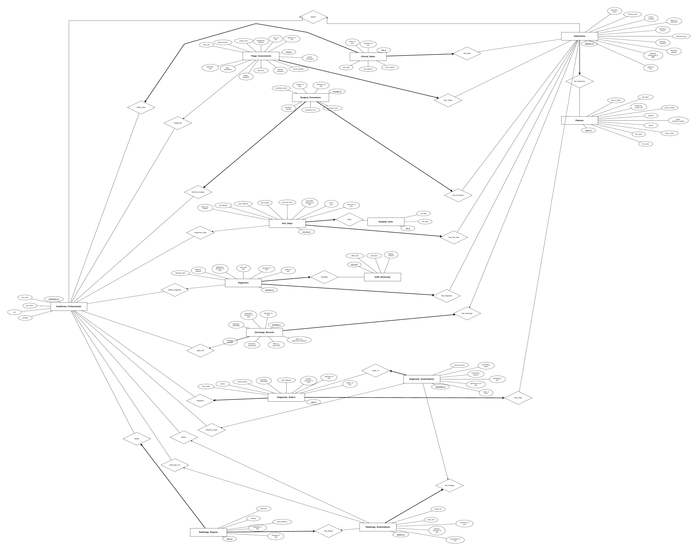

# Hospital Management System

SOEN 363 group project (Fall 2026, Concordia University, Prof. Hamed Jafarpour).
A PostgreSQL database for a hospital: patients, admissions, triage, clinical notes, diagnoses (ICD-9),
diagnostic orders and examinations, radiology, surgery, unit stays and discharges.

**Team:** Lamees, Sayf, Dany, Krish, Youssef

All data is synthetic and created for coursework. No real patients, staff or records are represented.

## Repository layout

```
schema/schema.sql         Tables, constraints, indexes, foreign keys and the radiology_exam_details view
data/data.sql             Sample data for all 15 tables
queries/                  The 20 project queries (query01.sql to query20.sql)
docs/er-diagram.png       ER diagram
```

## Restoring the database

Requires PostgreSQL 18. The dump files contain `\restrict` lines that only `psql` understands,
so run them with `psql`, not the pgAdmin Query Tool.

## Development setup

Create and activate a virtual environment, then install the project dependencies:

```bash
python3 -m venv .venv
source .venv/bin/activate
python -m pip install -r requirements.txt
cp .env.example .env
```

On Windows PowerShell, activate with `.venv\Scripts\Activate.ps1` and copy the example
with `Copy-Item .env.example .env`. Update `.env` with your database credentials when
the Neon database is available. The checked-in `.env.example` contains placeholders;
`.env` is ignored by Git.

```bash
createdb -U postgres hospital_management
psql -U postgres -d hospital_management -f schema/schema.sql
psql -U postgres -d hospital_management -f data/data.sql
```

On Windows, `psql` and `createdb` are in `C:\Program Files\PostgreSQL\18\bin\`.

## Tables

| Table | Rows | Description |
|---|---:|---|
| `patients` | 50 | Demographics, insurance number, life status |
| `healthcare_professionals` | 16 | Physicians, surgeons, nurses, radiologists, technicians |
| `hospital_units` | 8 | Emergency, ICU, CCU, MICU, SICU, wards |
| `icd9_dictionary` | 11 | ICD-9 diagnosis codes |
| `admissions` | 120 | Hospital stays with type, source and status |
| `triage_assessments` | 121 | Vitals, pain level, priority at arrival |
| `clinical_notes` | 358 | Initial assessments, progress notes, discharge summaries |
| `diagnoses` | 167 | Primary, secondary and preliminary diagnoses per admission |
| `diagnostic_orders` | 214 | Tests ordered by physicians |
| `diagnostic_examinations` | 205 | Tests performed |
| `radiology_examinations` | 85 | Imaging details for radiology exams |
| `radiology_reports` | 85 | Radiologist findings and impressions |
| `surgical_procedures` | 33 | Procedures, surgeon, operating room |
| `unit_stays` | 168 | Movement between hospital units |
| `discharge_records` | 118 | Destination, condition, follow-up |

## Queries

Run any query with `psql -U postgres -d hospital_management -f queries/query01.sql`, or open it in the pgAdmin Query Tool.

| # | Question |
|---|---|
| [01](queries/query01.sql) | List the names and admission dates of all patients who were classified as high-priority emergency patients during triage. |
| [02](queries/query02.sql) | Find all patients who had more than three hospital admissions. Display the patient identifier, patient name, and total number of admissions. |
| [03](queries/query03.sql) | Retrieve the names, admission dates, and discharge dates of patients who were discharged without undergoing any surgical procedure during the admission. |
| [04](queries/query04.sql) | List all patients who had both a radiology examination and a surgical procedure during the same admission. |
| [05](queries/query05.sql) | Find all ICU or CCU unit stays that lasted more than seven days. Display the patient name, unit type, unit entry time, unit exit time, and calculated length of stay. |
| [06](queries/query06.sql) | Count the total number of hospital admissions for each patient. Include patients who have no recorded admissions. |
| [07](queries/query07.sql) | List all patients who entered the hospital through the Emergency Department and were later transferred to an ICU or CCU during the same admission. |
| [08](queries/query08.sql) | Retrieve the most frequently assigned primary ICD-9 diagnosis among admissions that included at least one ICU or CCU stay. Display the ICD-9 code, its official description, and the number of times it was assigned. |
| [09](queries/query09.sql) | Calculate the average length of stay for each critical care unit type, such as MICU, SICU, ICU, and CCU. Display the unit type and its average length of stay. |
| [10](queries/query10.sql) | List all patients who underwent a surgical procedure before entering an ICU or CCU during the same admission. Display the patient name, procedure date and time, critical care unit type, and unit entry time. |
| [11](queries/query11.sql) | Retrieve the name of each patient and the total number of radiology examinations received across all admissions. Include patients who have not received any radiology examinations and display zero for their examination count. |
| [12](queries/query12.sql) | Find all patients whose discharge-summary clinical note contains the keyword “recovery”. The search should be case-insensitive. |
| [13](queries/query13.sql) | List all admissions in which the patient had at least one radiology examination but had no recorded ICU or CCU stay. |
| [14](queries/query14.sql) | Retrieve the patient or patients with the longest completed hospital stay, calculated from admission time to discharge time. If multiple patients have the same maximum length of stay, display all of them. |
| [15](queries/query15.sql) | Count the total number of transfers between hospital units for each patient. The patient’s first unit placement is not considered a transfer; each subsequent unit stay within the same admission represents one transfer. |
| [16](queries/query16.sql) | List all patients who stayed in more than one type of critical care unit during the same admission. For example, a patient may have been transferred from an ICU to a CCU. |
| [17](queries/query17.sql) | Find all admissions during which the patient received more than one distinct ICD-9 diagnosis. Display the patient name, admission identifier, and number of distinct ICD-9 codes. |
| [18](queries/query18.sql) | Retrieve the latest clinical note for each patient. Display the patient name, note type, note creation date and time, and note contents. |
| [19](queries/query19.sql) | List all admissions where the patient’s discharge status or discharge condition indicates that the patient died during the hospital stay. Display the patient name, admission date, recorded date of death, and associated primary ICD-9 diagnosis. |
| [20](queries/query20.sql) | Find all patients who underwent a surgical procedure and a radiology examination on the same calendar day during the same admission. Display the patient name, admission identifier, procedure type, radiology examination type, and the common date. |

## ER diagram



## Updating the dumps

After changing the database in pgAdmin, re-export with **right-click the database → Backup…**,
Format **Plain**, once with **Only schema** (`schema/schema.sql`) and once with **Only data** (`data/data.sql`).
